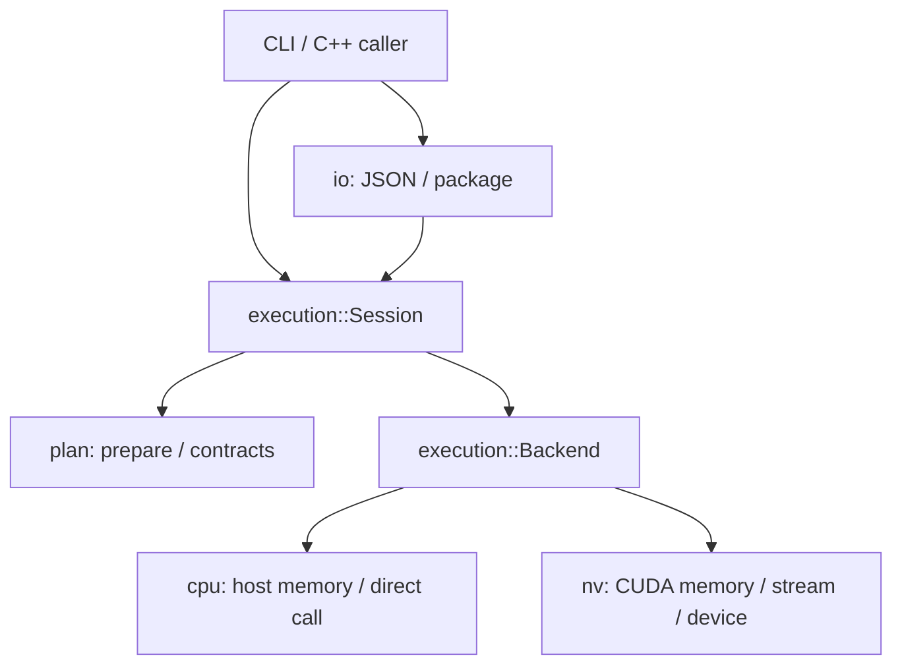

# 18 执行器与后端

当前实现提供一个公共执行器和 CPU、NVIDIA CUDA 两个 backend。两者的宿主接口都是同步 `run(inputs)`，输入与返回结果均为宿主内存；CUDA 的中间 tensor、常量和 workspace 在显存中。

## 1 抽象调整的理由

原来的 `plan/` 和 `io/` 分层是合理的：图准备只处理数据流与契约，目录包加载不执行动态库。这两层继续保持无算子语义、无 CUDA 依赖。

需要调整的是 `cpu::Session` 的职责。它同时包含 prepare、dlopen/caps 校验、绑定检查、调度、结果所有权与 CPU 内存操作；直接复制它实现 CUDA 会产生两份执行规则。现在将前一组职责移到 `execution::Session`，CPU/CUDA 只实现设备差异。



| 层 | 负责内容 | 不承担的内容 |
|---|---|---|
| `plan/` | 图、调度、tensor 与入口契约 | 内存、动态库、设备 API |
| `io/` | JSON/schema、路径、宿主兼容、常量文件 | GPU 探测、二进制执行 |
| `execution/` | Session、库加载、caps、输入检查、调度、输出寿命、包绑定适配 | CUDA 类型、算子实现 |
| `cpu/`、`nv/` | 分配、传输、清零、入口调用及完成保证 | 再实现图调度或契约校验 |
| KernelUnit | 实际计算、grid/block、厂商库调用 | 拥有引擎的 stream 或修改图 |

`Backend` 是 Session 独占的执行上下文，不是算子注册表。`allocate/upload/download/zero/invoke` 返回或抛出前，须完成本次提交的工作。这样公共层在异常展开时可以安全释放 buffer、workspace 和动态库。内存对象自行拥有释放所需的信息，不依赖 Backend 对象继续存活。

没有加入 event、CUDA Graph、算子、tile 或调优接口：目前的同步执行路径不需要它们。后续若引入跨节点异步调度，必须明确增加完成事件与所有权契约，不能直接删除现有同步。

## 2 保留与新增的 API

已有 `cpu::Session` 构造方式、`cpu::make_session/load_package` 及错误类型名保留。`nv::Session` 提供相同图接口，最后一个可选参数为设备 ordinal，默认 0。

通用调用方也可注入 backend：

```cpp
#include "execution/package.h"
#include "nv/backend.h"

auto package = loom::io::load_package("build-cuda/examples/cuda.loom");
auto session = loom::execution::make_session(package, loom::nv::make_backend(0));
const auto input = loom::io::load_tensor(
    package.root / "inputs/0.bin", package.program.tensors.at(0).info);
auto result = session->run({{input.data.get(), input.bytes}});
// result.outputs 的 data 是有所有权的宿主指针，销毁 session 后仍有效。
```

快捷入口为 `nv::load_package(path, device)`。设备指针不属于 `BufferView` 的宿主接口；输入仍须满足 slot 的容量、对齐与互不重叠约束。`run()` 尚不承诺同一 Session 并发调用安全。

## 3 CUDA 执行与 ABI

实验 ABI 保留 v1 结构布局与符号，新增 backend 值和 flags；旧 CPU KernelUnit 的声明不变。CPU 要求 `LM_EXP_BACKEND_CPU + LM_EXP_SYNCHRONOUS`，CUDA 要求 `LM_EXP_BACKEND_CUDA + LM_EXP_STREAM_ORDERED`。错误 backend 或 flags 在执行前拒绝。

- 每个 CUDA Session 拥有一个 non-blocking stream。每次 CUDA 操作切到目标设备，完成后恢复调用线程原来的设备。
- 创建 Session 时复制常量到显存；每次 run 上传输入、分配内部 tensor 与 workspace。只下载图输出，重复输出 ID 共享一份宿主存储。
- launcher 收到的描述符和 params 是宿主指针，tensor data 与 workspace 是设备指针。`stream` 是运行时提供的 `cudaStream_t`，所有工作都必须提交到该 stream。
- launcher 不得保留宿主描述符/params 地址。示例将标量按值传给 CUDA kernel，避免异步任务引用已销毁的栈数据。
- 当前逐节点调用 `cudaStreamSynchronize`。launcher 返回非零状态也先等待已提交工作结束；设备执行错误带当前 node，后续节点不执行。
- 对齐分配采用适量超分配并保存原始 CUDA 地址，支持超过默认 CUDA 对齐保证的 slot/workspace；空 tensor 不分配设备存储。

同步语义依据 [CUDA 异步执行文档](https://docs.nvidia.com/cuda/cuda-programming-guide/02-basics/asynchronous-execution.html)。当前选择优先保证错误归属和资源寿命，会增加节点间同步开销；没有做吞吐性能承诺。非法地址等严重 CUDA 错误可能使当前 CUDA context 不再可用，不能将所有失败都视为可重试。

目录包使用 `backend: "cuda"`、`abi: "loom.cuda.exp.v1"`、`compute_capability: 120`（示例），加载执行时要求与设备精确匹配。这个策略有意保守，尚未建模跨 SM 的 PTX 兼容矩阵、特定架构后缀或驱动版本需求。直接用图构造 Session 时没有 package target，二进制不兼容会由 CUDA 加载/执行报错。

## 4 构建与运行

默认构建与 `LOOM_ENABLE_EXPERIMENTAL_ABI=ON` 的 CPU 构建均不需要 CUDA。CUDA 构建需要 POSIX、CUDA Toolkit、可用驱动；以下以 SM 120 为例，按实际目标 GPU 修改：

```bash
cmake -S . -B build-cuda \
  -DLOOM_ENABLE_EXPERIMENTAL_ABI=ON \
  -DLOOM_ENABLE_CUDA=ON \
  -DCMAKE_CUDA_ARCHITECTURES=120 \
  -DCMAKE_BUILD_TYPE=Debug
cmake --build build-cuda -j
ctest --test-dir build-cuda --output-on-failure

./build-cuda/loom-cli inspect build-cuda/examples/cuda.loom
./build-cuda/loom-cli run build-cuda/examples/cuda.loom build-cuda/output \
  build-cuda/examples/cuda.loom/inputs/0.bin
```

示例仍为 `relu(x + bias) * 2`，输出 `0 0 0 2 4 6`。CPU/CUDA 使用同一个图构造器、包模板和输入数据；KernelUnit 各自编译为不链接 Loom 的共享库。示例 kernel 只实现 scalar/1D f32 及正 stride，不限制运行时可声明的 tensor dtype/rank。

`CMAKE_CUDA_ARCHITECTURES` 可以设置多个架构，示例包默认声明其中第一个数字架构。使用 `native/all` 时需另外指定数字 `LOOM_CUDA_PACKAGE_SM`。这个变量只标注包目标，不改变生成代码的架构。

## 5 验证边界

`execution_test.cpp` 同时编译为 CPU/CUDA 测试，覆盖数值结果、乱序节点、输入绑定、常量快照、输出顺序/重复/寿命、scalar/empty/stride/padding、失败后的前置校验与参数错误。CPU 的原有故障动态库测试继续覆盖公共 caps、符号和协议校验。

CUDA 专项测试覆盖设备内存 4096 字节对齐、传输与清零、资源独立寿命、非法设备、backend/SM 不匹配、包执行、CLI 输出字节，以及 launcher 返回错误时等待 stream、停止后继节点、异步设备错误归属。无可用 CUDA 设备时 GPU 执行测试显示 skipped，元数据测试仍执行。多 GPU 的设备切换分支需要多卡机器验证。

宿主 ASan/UBSan 检查适用于 C/C++ 代码，不替代 GPU 内存检查。当前未实现跨节点异步流水、设备指针公开绑定、buffer pool、event、CUDA Graph 或性能调优。
